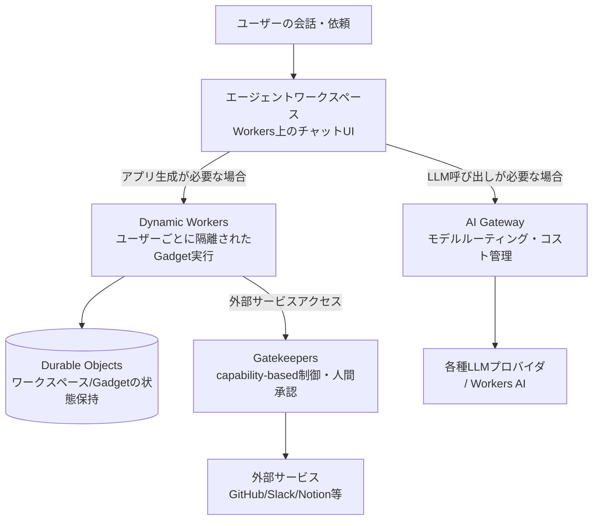

---
tags:
  - cloudflare
  - oss
  - ai-platform
  - serverless
created: 2026-09-05
---
## 概要

Cloudflare OSは、Cloudflareが2026年8月に発表したオープンソースの「AI向けオペレーティングシステム」。従来型OS(カーネル/プロセス管理)ではなく、以下を指す:

- 企業がAIを安全に生産活用するための基盤
- AIワークロード(エージェント/アプリ実行)を管理する基盤

Cloudflare社内で先行運用されていたものをApache 2.0でOSS化し、「Your Company OS」として他社が自社向けにカスタマイズできる形で公開された。GitHub: `cloudflare/cloudflare-os`(v2、リライト版、Early Access)。

## 詳細説明

### 構成する3要素

1. **エージェントワークスペース**: ブラウザのチャットUI。会社独自のコンテキスト・スキルを踏まえてAIエージェントに作業を依頼できる
2. **Gatekeepers(セキュリティ/ガバナンス層)**: capability-basedのアクセス制御。エージェント/Gadgetは既定で外部に何もアクセスできず、明示的に「紹介(introduce)」した資源のみアクセス可能
3. **Gadgets(パーソナルアプリ基盤)**: 会話から生成されたアプリ。ユーザーごとに隔離実行される「使い捨てソフトウェア」

### 技術基盤(Workers/Dynamic Workers/AI Gateway)

- **Cloudflare Workers**: エッジで動くサーバーレス実行基盤(V8 Isolateベース、低レイテンシ、コールドスタートがほぼない)。Cloudflare OS全体の土台
- **Dynamic Workers**: 実行時に動的生成されるWorker。各Gadgetのサーバー側コードはこの上でユーザーごとに隔離実行される(インターネットアクセスは既定で無効化、Workers Bindings経由で明示的に許可した外部資源のみ通信可能)
- **Durable Objects**: ワークスペース単位・Gadget単位でステートを保持するCloudflareのステートフル・サーバーレスプリミティブ。リアルタイム共同編集の実現に使われる
- **AI Gateway**: 複数LLMプロバイダへのリクエストを一元管理するプロキシ層。ルーティング・キャッシュ・コスト管理を担当(LLMスタックの「アグリゲーター層」に相当)

### OS的な対応関係(READMEより)

| 通常のOS | Cloudflare OS |
|---|---|
| カーネル | workshop-backend パッケージ |
| デバイスドライバ | gatekeeper-* パッケージ |
| シェル | workshop-frontend パッケージ |
| プロセス | Gadgets |
| 実行ファイル | Blueprints |
| ACL | 共有パーミッション |
| (該当なし) | agents |

### Gatekeeperの特徴的な仕組み

- 各外部サービスへの接続を仲介する専用Worker(MCPサーバーの強化版と説明されている)
- 副作用のある操作は人間の承認が必要だが、**非同期承認**が可能。エージェントは承認待ちで止まらず、結果をシミュレートしながら処理を継続でき、人間は後でまとめて承認/却下できる
- 例外: MCP Gatekeeper では書き込みをシミュレートできないため、承認待ちの間エージェントが停止する。後でまとめて承認できる前提で作業を任せると途中で止まる

### 導入方法

1. **ローカル実行**: `cloudflare-os` リポジトリを clone してディレクトリに移動し、pnpm を用意した上で `pnpm run-local` → `localhost:8787`。`wrangler`+`workerd`でローカル完結。Cloudflareアカウント不要、本番用途ではない
2. **自分のCloudflareアカウントへデプロイ**: `os.cloudflare.app/deploy` のオンラインフロー、またはより高度な設定向けの `cloudflare-os-starter` リポジトリ。Workers, KV, R2, Durable Objects, Dynamic Worker Loaders, Workers AI, AI Gatewayが必要
3. **自前サーバーで`workerd`のみで完結**: `workerd` 上での実行自体は上流READMEに記載があるが、デプロイ用のドキュメントとツールは **Coming Soon(未整備)**。Cloudflareクラウドへの依存を完全に切り離す手順はまだない

### ホームラボでの現実性

- OpenWrtルーター上では動作不可(組み込みLinuxでNode.js/pnpm実行は非現実的)。ミニPC等のサーバー機での実行が前提
- ローカル検証(`pnpm run-local`)は今すぐ可能、Cloudflareアカウント不要
- 本番相当の運用にはCloudflareクラウド(Workers AI/AI Gateway等)への依存とコスト許容が必要。Durable Objects/Dynamic Workersは使用量課金の可能性がある
- self-hosted向けのデプロイ用ドキュメント・ツールは未整備のため、vendor lock-in回避を重視する場合は現時点で制約がある
- Prometheus/Grafana向けのネイティブexporterは確認できず、連携する場合はCloudflareのWorkers Observability/Analytics APIから自前で取得する必要がありそう(未検証)

## 図解

## まとめ

- Cloudflare OSは「エージェントに安全にコードを書かせて実行させる基盤」という独自ポジション。Glean(企業ナレッジ検索)やMicrosoft Copilot(M365統合)とは思想が異なり、self-hostable志向の点ではDustに近い
- 技術的にはWorkers(実行基盤)、Dynamic Workers(隔離実行)、Durable Objects(状態保持)、AI Gateway(LLM管理)、Gatekeepers(外部アクセス制御)の組み合わせで成立している
- ホームラボでの「お試し」は今すぐ可能だが、「vendor lock-inを避けた本番自宅インフラ」としては、self-hosted向けのデプロイ用ドキュメント・ツールが未整備である点がネックになる

## 参考リンク

- https://github.com/cloudflare/cloudflare-os
- https://github.com/cloudflare/cloudflare-os-starter
- https://blog.cloudflare.com/cloudflare-os/
- https://os.cloudflare.app/

### 関連項目

- [[ベンダーロックフリーなFaaS]]
- [[LLMエコシステムの4層構造]]
