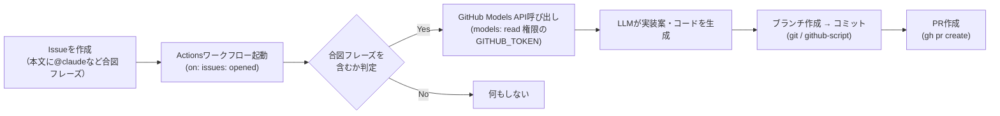

---
tags:
  - github-actions
  - github-models
  - automation
  - ci-cd
created: 2026-09-05
---
## 概要

GitHub Issueを作成すると自動でPull Requestまで作成してくれる仕組みを、**完全無料**で構築する。Claude Code GitHub ActionsやGitHub Copilot Coding Agentは高機能だが無料枠が事実上存在しないため、**GitHub Models**（GitHubアカウントだけで使える無料LLM推論API）をベースに自作のGitHub Actionsワークフローを組む方式を採用する。

トリガー条件は「Issue本文中に`@claude`（または任意の合図）を含めたときのみ動作」とする。

## 詳細説明

### なぜGitHub Modelsなのか

| 選択肢 | 無料か | 備考 |
|---|---|---|
| GitHub Copilot Coding Agent | ✕ | Pro（$10/月〜）以上が必須。無料プランには含まれない |
| Claude Code GitHub Actions | △ | Anthropic APIに恒久無料枠なし。新規登録時の$5トライアルクレジットのみ |
| Cursor Automations | ✕ | Cursor Pro相当の契約が前提 |
| **GitHub Models** | **○** | GitHubアカウントの`GITHUB_TOKEN`に`models: read`権限を付けるだけで、追加登録・追加課金なしに利用可能 |

GitHub Modelsは、GitHub Actionsワークフロー内で組み込みの`GITHUB_TOKEN`に`models: read`権限を追加するだけで、追加のAPIキー取得手続きなしにLLM推論を呼び出せる。ワークフローが実行するのはあくまで「単発のLLM呼び出し」であり、Claude Agent SDKのような「ファイル読み書き・テスト実行・エラー修正の自律ループ」機能は持たない。そのため、実現できるのは「Issue文面をもとに単一ファイル相当のコードを生成し、それをブランチにコミットしてPRを作る」という比較的シンプルな範囲にとどまる。

### 全体の処理フロー

1. Issueが作成される（本文に`@claude`のような合図フレーズを含む）
2. `on: issues: opened`イベントでGitHub Actionsワークフローが起動
3. ワークフロー内でIssue本文に合図フレーズが含まれるかをチェック（条件分岐）
4. GitHub Models APIにIssue内容を渡し、実装案・コードを生成させる
5. 生成されたコードで新しいブランチを作成しコミット
6. `gh pr create`等でPRを作成

### 実装の骨子

**1. 権限設定**
ワークフローファイルの`permissions`に以下を指定する。

```yaml
permissions:
  contents: write        # ブランチ作成・コミットに必要
  models: read            # GitHub Models呼び出しに必要
  pull-requests: write     # PR作成に必要
  issues: read             # Issue内容の読み取りのみ（write権限は与えない）
```

必要最小限の権限のみ付与するのが公式推奨。Issue内容を読むだけならissues権限をwriteにしないなど、悪意あるIssue内容がモデルに不正な指示を注入するリスクを抑える設計にする。

**2. モデル呼び出しの2つの方法**

- 公式アクション`actions/ai-inference@v1`を使う方法（model名・system-prompt・promptを渡すだけ）
- 直接API（`https://models.github.ai/inference/chat/completions`）にcurlでPOSTし、`Authorization: Bearer $GITHUB_TOKEN`ヘッダーを付ける方法

**3. モデル選択**
OpenAI GPT-4o（複雑な分析向け）、GPT-4o mini（軽量タスク向け）、Meta Llama 3.1（8B/70B/405B）などから選べる。単一ファイル生成程度であればGPT-4o miniで十分な可能性が高い。

**4. Issue→ブランチ→PRの結線**
LLMの出力（生成コード）をファイルとして書き出し、`git checkout -b`でブランチを作成、コミットしてから`gh pr create`でPRを開く、という一連の処理をワークフローのシェルステップとして自分で記述する必要がある。ここは既製品（Copilot Coding Agent等）が内部で自動化している部分にあたる。

## 図解



## まとめ

- Claude Code GitHub Actions・GitHub Copilot Coding Agent・Cursor Automationsはいずれも無料では継続運用できず、GitHub Modelsが唯一の完全無料ルート。
- GitHub Modelsは「単発のLLM呼び出しAPI」であり、自律的なエージェントループ（ファイル操作・テスト・自己修正の反復）は持たないため、既製のCloud Agent系サービスに比べると自作すべき範囲が広い。
- 実現可能な範囲は「Issue文面→比較的シンプルなコード生成→PR化」程度。複雑なマルチファイル修正やテスト駆動の反復修正には不向き。
- セキュリティ面では、Issueは誰でも書き込める入力経路になりうるため、ワークフローの権限は必要最小限に絞ることが重要（プロンプトインジェクション対策）。
- 今後、より高度な自律修正（テスト失敗時の自己修正ループなど）が必要になった場合は、コスト面を許容してClaude Code GitHub ActionsのAPI従量課金に切り替える、という段階的な移行も選択肢になる。

## 参考リンク

- [Quickstart for GitHub Models（GitHub公式ドキュメント）](https://docs.github.com/en/enterprise-cloud@latest/github-models/quickstart)
- [Automate your project with GitHub Models in Actions（GitHub Blog）](https://github.blog/ai-and-ml/generative-ai/automate-your-project-with-github-models-in-actions/)
- [Solving the inference problem for open source AI projects with GitHub Models（GitHub Blog）](https://github.blog/ai-and-ml/llms/solving-the-inference-problem-for-open-source-ai-projects-with-github-models/)
- [actions/ai-inference（GitHub公式アクション）](https://github.com/actions/ai-inference)
- [Claude Code GitHub Actions（比較検討時の参照）](https://code.claude.com/docs/en/github-actions)

### 関連項目

- [[LLMエコシステムの4層構造]]
- [[opencodeのcron定期実行]]
