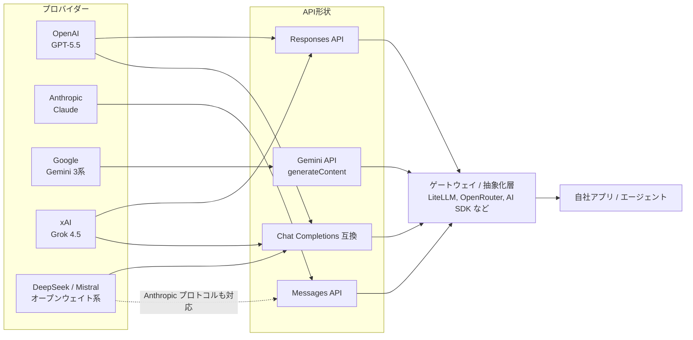
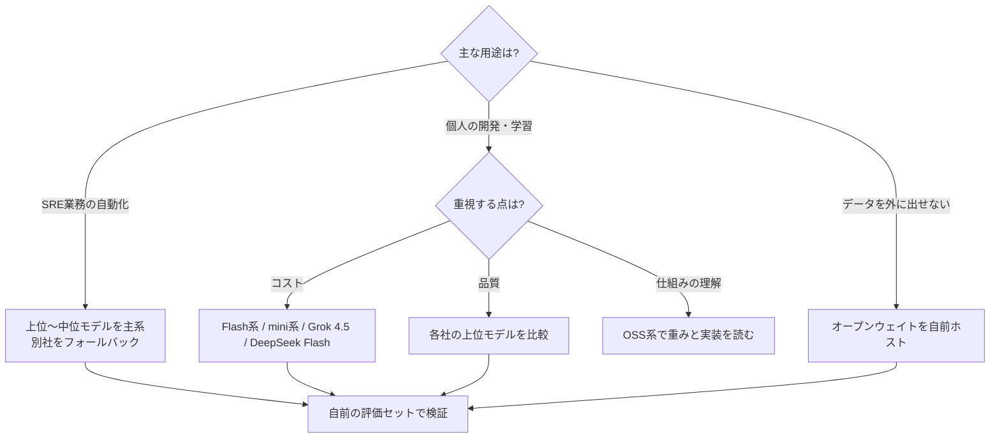

---
tags:
  - llm
  - provider
  - api
  - agent
  - comparison
created: 2026-11-04
---
## 概要

2026年10月31日時点で、主要プロバイダー（OpenAI / Anthropic / Google / xAI / DeepSeek・Mistral 等）の**直接API**を、モデルの性能・得意分野とエコシステム・開発者体験（API形状、SDK、ツール連携）の2軸で整理する。想定する使い方は「SRE業務の自動化・運用支援」と「個人の開発・学習・自動化」。

## 先に結論

- フロンティア級の上位モデルは各社とも1M前後の長文脈・推論強度の調整・ツール呼び出しを備え、**性能差よりもAPI形状・エージェント基盤・運用面の差**が選定に効きやすい。
- API形状は Responses / Messages / generateContent / Chat Completions互換 の4系統。**OpenAI互換が事実上の共通語**で、ゲートウェイ層を挟めば切り替えコストは低い。
- 世代交代が数ヶ月単位で速い。**モデルIDを設定化し、自前の評価セットで検証する**前提で選ぶ。

## 情報の確度について

| 区分 | 内容 |
|---|---|
| 一次情報に近い | OpenAI の GPT-5.5 モデルページ、Anthropic の Models overview、DeepSeek V4 の API ドキュメント由来の報道 |
| 二次情報 | 価格・ベンチマークをまとめる比較サイト、解説記事（Grok 4.5 の価格など） |
| 要再確認 | Gemini 3.5〜3.7 世代の詳細（検索で得られた記事の信頼度が低い）、GPT-5.6 ファミリー、Mistral の最新世代 |

ベンチマーク値はベンダー自己申告を含むため、このノートでは数値の優劣は書かず、位置づけのみ記す。

## 詳細説明

### 各社のプロファイル

**OpenAI**
- 主力は GPT-5.5（2026-04-23 リリース）。API のコンテキストは約1.05M、最大出力128K。`reasoning.effort` は none / low / medium / high / xhigh で調整できる。
- 上位に GPT-5.5 Pro がある。小型は GPT-5.4 mini / nano（2026-03）。二次情報では GPT-5.6 ファミリーにも言及があるが、詳細は未確認。
- 主APIは Responses API。Chat Completions も継続。Web検索・ファイル検索・Code Interpreter・Computer Use・リモートMCPを1回の呼び出しで組み合わせられる。
- Assistants API は 2026-08-26 に終了予定と告知されていた。Responses への移行が前提。
- エージェント基盤は Agents SDK（ネイティブのサンドボックス対応の更新あり）。

**Anthropic**
- 現行ラインは Fable 5.1 / Opus 5.5 / Sonnet 5.5 / Haiku 5.5（API ID は `claude-fable-5-1`, `claude-opus-5-5` など）。公式Docsは、迷ったら Opus 系から、難度の高い推論や長時間エージェント作業は Fable 5.1 を勧める位置づけ。
- Docs上、上位モデルは1Mコンテキストで、adaptive thinking と effort 指定に対応。
- 主APIは Messages API。MCP の提唱元で、Claude Code・Agent SDK・Managed Agents など周辺が厚い。
- 提供経路は Claude API のほか、Amazon Bedrock / Vertex AI / Microsoft Foundry。
- 運用上の留意点: 旧モデルには退役日が設定される。2026-06-12〜07-01 には Fable / Mythos へのアクセスが輸出管理の関係で一時停止された事例がある（声明は参考リンク参照）。

**Google**
- Gemini 3 世代（2025-11-18 リリース）が基軸。Deep Think は推論強化版。Vertex AI の連携ドキュメントには 3.1 Pro preview の記載がある。
- 2026年夏に 3.5〜3.7 世代の Flash 系が順次登場、3.5 Pro は遅延との報道がある。最新ラインは要再確認。
- Gemini API（AI Studio / APIキー認証）と Vertex AI（GCP の IAM 認証）の2系統。クォータや認証の体系が別。
- 開発基盤は ADK（Agent Development Kit）、Antigravity（エージェント開発環境）、Gemini CLI。得意分野の位置づけはマルチモーダル（テキスト・画像・動画・音声・コード）。

**xAI**
- 主力は Grok 4.5（2026-07-08 リリース）。モデルID `grok-4.5`、コンテキスト500K。価格は入力$2 / 出力$6 per 1M（二次情報）で、フロンティア級としては低め。
- Responses 形式のエンドポイントと OpenAI互換クライアントの両方で接続できる。
- Grok 5 は2026年8月時点の二次情報で未リリース。Grok 4.5 は公開時点で EU 未提供だった。

**DeepSeek / Mistral 等（オープンウェイト系）**
- DeepSeek V4 系: V4-Pro（2026-04-24、総1.6T / 活性49B）は提供継続。V4-Flash は 2026-09-10 に退役し、後継の V4.1 Flash（モデルID `deepseek-flash`）に置き換わった。V4.1 Flash は 2026-10-17 に `V4.1-Flash-1017` へ更新されている。MITライセンスで重みを公開し、1Mコンテキストがデフォルト。
- 公式APIは OpenAI の ChatCompletions と Anthropic のプロトコルの両方に対応し、Claude Code などのツールとの連携も明示されている。
- Mistral は Large 4 / Small 4 / Ministral 3 が現行（2026-10-31 時点）。Medium 3.1 は 2026-05-22 に、Large 3 と Medium 3.5 は 2026-10-31 に非推奨となり、新規統合には Large 4 が推奨される。Serverless 専用のモデルもあるため、OpenAI互換のエンドポイントで使えることと重みの公開は別問題。
- 重みが公開されているモデルは、ホストAPIを使うか自前ホストするかでデータの経路を選べる。自前ホスト可否はモデルごとに公開重みの有無を確認する（上位モデルは大規模GPUが必要）。

### 比較表

| 観点 | OpenAI | Anthropic | Google | xAI | DeepSeek / Mistral |
|---|---|---|---|---|---|
| 主力モデル | GPT-5.5 / 5.5 Pro | Fable 5.1 / Opus 5.5 / Sonnet 5.5 / Haiku 5.5 | Gemini 3 系（3.5〜3.7 Flash 系が追随） | Grok 4.5 | DeepSeek V4 Pro / V4.1 Flash、Mistral Large 4 ほか |
| 位置づけ・得意分野 | 汎用の最上位。画像・音声など製品面の幅が広い | 高難度推論・長時間エージェント・コーディング | マルチモーダルと深い推論（Deep Think） | 低価格帯のコーディング・エージェント用途 | オープンウェイト、長文脈、低コスト |
| コンテキスト | 約1.05M | 1M（上位モデル） | 要確認 | 500K | 1M（DeepSeek V4） |
| 主なAPI形状 | Responses（Chat Completions 継続） | Messages | Gemini API（generateContent） | Responses 形式 + OpenAI互換 | OpenAI互換（DeepSeek は Anthropic プロトコルも） |
| エージェント基盤 | Agents SDK | Agent SDK / Managed Agents / Claude Code | ADK / Antigravity / Gemini CLI | OpenAI互換クライアントで接続 | 既存ツール（Claude Code 等）から接続 |
| ツール連携 | Responses 内蔵ツール、リモートMCP | tool use、MCP | ADK 経由 | OpenAI互換のtool call | 互換API経由で各フレームワークから利用 |
| 提供経路 | 直接API | Claude API / Bedrock / Vertex AI / Foundry | AI Studio（APIキー）/ Vertex AI（IAM） | 直接API（console.x.ai） | 公式API + Hugging Face の重み |
| 留意点 | Assistants API は 2026-08-26 終了予定だった（Responses へ移行前提） | 世代交代と退役日、供給停止の前例 | プレビューが多く最新は要確認 | Grok 5 未リリース、地域提供の差 | モデル更新と退役が早い、自前ホスト可否とデータ経路の確認が必要 |

### 横断的に見えること

1. **API形状の収斂**: OpenAI互換のエンドポイントは xAI・DeepSeek・Mistral など多数が提供している。`base_url` と APIキーの差し替えで試せる範囲が広い。ゲートウェイ（LiteLLM、OpenRouter、Vercel AI SDK など）を挟むと、プロバイダー差を吸収しやすい。
2. **1M文脈の標準化**: OpenAI・Anthropic・DeepSeek が1M級。ログやトレースを丸ごと渡す設計が現実的になったが、OpenAI では長文脈に割増料金帯がある（272K超との情報、要確認）。コスト面は各社の料金ページで確認する。
3. **エージェント基盤は各社が自前**: Agents SDK、Claude Agent SDK、ADK のようにベンダーごとに分かれる。ベンダー中立にしたい層は MCP とゲートウェイで持つ。
4. **世代交代の速さ**: 数ヶ月単位でモデルが入れ替わり、API自体の終了（Assistants API）もある。モデルIDを設定化し、評価セットで回帰確認できる形にしておく。

### 用途別の選び方ガイド

以下は出発点となる仮説で、自前の評価で検証する前提。

**SRE業務の自動化・運用支援（障害対応、ログ解析、ランブック実行など）**
- 重視する点: ツール呼び出しの安定性、長いログを読める文脈長、権限分離と承認フロー、観測性。
- 出発点: Anthropic か OpenAI の上位〜中位モデルを主系にし、別社をフォールバックにする（ゲートウェイ経由）。
- 検証: 過去のインシデントとランブックで評価セットを作り、正答率・ツール呼び出し成功率・コスト・レイテンシを比較する。
- 運用: モデルIDの設定化、タイムアウト・リトライ・レート制限対応、書き込み系操作は人間承認を挟む。供給停止の前例があるため、単一ベンダー依存を避ける。

**個人の開発・学習・自動化**
- コスト重視なら Flash 系 / mini 系 / Grok 4.5 / DeepSeek V4.1 Flash が候補。
- OpenAI互換クライアントで `base_url` を切り替え、同じコードで複数社を試す。
- 仕組みの学習には、重みが公開されている OSS 系（DeepSeek、Mistral など）が向く。
- CLIエージェント（Claude Code、Codex、Gemini CLI）を使い比べると、基盤ごとの設計思想の差が分かりやすい。

## 図解

### プロバイダー・API形状・抽象化層の関係

### 選び方の流れ（出発点）

## まとめ

- 上位モデルの能力は各社とも1M級の文脈と推論強度の調整まで揃っており、**選定の決め手は「API形状・エージェント基盤・運用リスク」**になりやすい。
- 得意分野の位置づけは、Anthropic が長時間エージェントとコーディング、OpenAI が汎用と製品面の幅、Google がマルチモーダル、xAI と DeepSeek が低コストとオープン性。ただしベンチマークは自己申告を含むため、自前評価で確かめる。
- 実務では、OpenAI互換とゲートウェイで切り替えやすくし、モデルIDを設定化し、MCP でツール連携をベンダー中立に保つ構成が堅い。
- 今後の確認事項: Gemini 3.5 以降の最新ラインと価格、GPT-5.6 ファミリーの詳細、各社のデータ取り扱いと料金（今回の比較軸の対象外）。

## 参考情報

### 参照元

| ソース | URL | 内容 |
|--------|-----|------|
| OpenAI: GPT-5.5 モデルページ | https://developers.openai.com/api/docs/models/gpt-5.5 | 主力モデルの仕様 |
| OpenAI: API 料金 | https://developers.openai.com/api/docs/pricing | 料金体系 |
| OpenAI Developer Community: アナウンス一覧 | https://community.openai.com/c/announcements/6 | モデル・API の告知 |
| InfoQ: OpenAI Responses API と Agents SDK | https://www.infoq.com/news/2025/03/openai-responses-api-agents-sdk | API 形状とエージェント基盤 |
| Anthropic: Models overview | https://platform.claude.com/docs/en/models/overview | モデル一覧・コンテキスト |
| Anthropic: Fable / Mythos アクセスに関する声明 | https://www.anthropic.com/news/fable-mythos-access | 一時停止の経緯 |
| InfoQ: Google Gemini 3 | https://www.infoq.com/news/2025/11/google-gemini-3/ | Gemini 3 世代の概要 |
| Google ADK: Gemini モデルの認証 | https://google.github.io/adk-docs/agents/models/google-gemini | AI Studio / Vertex AI の違い |
| Lambda: DeepSeek V4 の解説 | https://lambda.ai/blog/deepseek-v4-the-most-expected-open-source-model | V4 の構成 |
| Let's Data Science: DeepSeek V4 Preview | https://letsdatascience.com/news/deepseek-v4-preview-adds-open-weight-1m-context-models-4a8f21c6 | 1M コンテキストの報道 |
| Apidog: Grok 4.5 API ガイド（二次情報） | https://apidog.com/de/blog/grok-4-5-api/ | 価格・API 形状 |

### 関連項目

- [[LLMエコシステムの4層構造]] - プロバイダー・API・ツール・アプリの層の整理
- [[AIエージェントのコンテキスト管理]] - 長文脈・ツール呼び出しの設計と運用
- [[LLMハルシネーション]] - 出力の信頼性を前提にした評価の考え方
