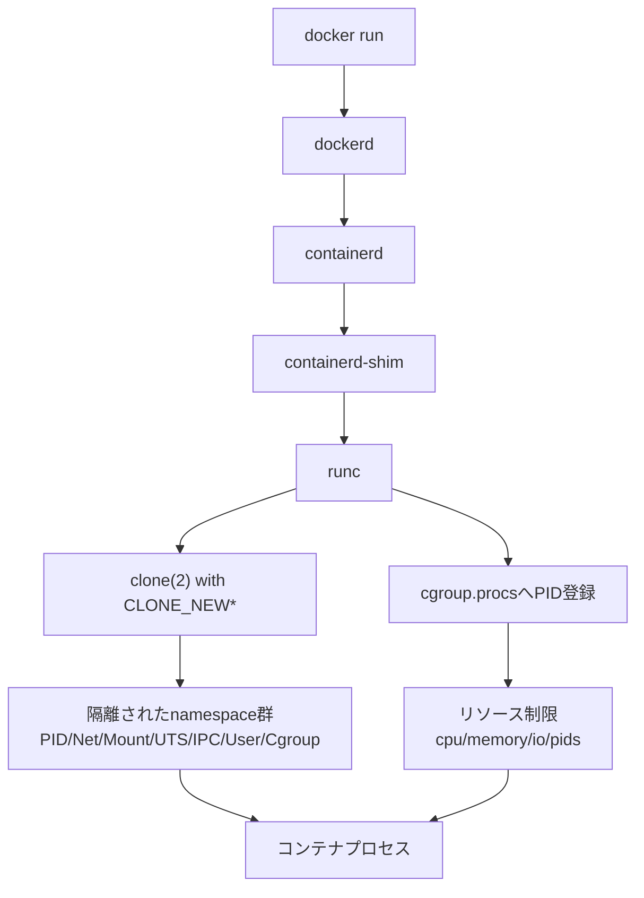

---
tags:
  - linux
  - container
  - docker
  - namespace
  - cgroups
created: 2026-09-05
---
## 概要

Dockerなどのコンテナ技術は、新しい仮想化方式ではなく、**Linuxカーネルが元々持っている2つの機構の組み合わせ**で実現されている。

- **namespace**: プロセスから見える「世界」を分離する機構(何が見えるか)
- **cgroups (control groups)**: プロセスが使えるリソース量を制限・計測する機構(何がどれだけ使えるか)

VMがハードウェアレベルで仮想化するのに対し、コンテナは**同一カーネルを共有しながらプロセスの視界とリソースだけを隔離する**、OSレベルの仮想化である。Dockerはこれらのカーネル機能をラップし、使いやすくしたツールに過ぎない。

---

## 1. namespace: プロセスの視界を分離する

namespaceは「あるリソースの名前空間をプロセスごとに独立させる」機構。カーネル内部では各プロセス(`task_struct`)が、どのnamespaceに属しているかを保持しており、同じnamespaceに属するプロセス同士だけが互いを見える。

### 主要syscall

| syscall | 役割 |
|---|---|
| `clone(2)` | 新しいプロセス作成時に `CLONE_NEW*` フラグでnamespaceを新規作成しつつ子プロセスをそこに配置 |
| `unshare(2)` | 既存プロセス自身を新しいnamespaceに切り離す(子プロセス生成を伴わない) |
| `setns(2)` | 既存の(他プロセスが使っている)namespaceに、自分自身を参加させる。`docker exec`はこれを使う |

### 7種類のnamespace

| namespace | フラグ | 分離対象 |
|---|---|---|
| PID | `CLONE_NEWPID` | プロセスID空間。コンテナ内では自分がPID 1に見える |
| Mount | `CLONE_NEWNS` | マウントポイント(ファイルシステムツリー)。最初に実装されたnamespace |
| UTS | `CLONE_NEWUTS` | hostname・domainname |
| IPC | `CLONE_NEWIPC` | System V IPC・POSIXメッセージキュー |
| Network | `CLONE_NEWNET` | ネットワークデバイス・IPアドレス・ルーティングテーブル・ポート空間 |
| User | `CLONE_NEWUSER` | UID/GIDのマッピング。コンテナ内root(UID 0)をホストの非特権ユーザーにマップできる |
| Cgroup | `CLONE_NEWCGROUP` | プロセスから見えるcgroupディレクトリ階層のルート位置 |

### 各namespaceの補足ポイント

**PID namespace**
- 入れ子構造(階層)を持つ。ホストからは全プロセスが見えるが、コンテナ内からは自分のnamespace配下しか見えない。
- コンテナ内PID 1が持つ特殊挙動(シグナルのデフォルトハンドラが無視される等)を意識しないと、`SIGTERM`が効かない、ゾンビプロセスが回収されない、といった障害の原因になる。

**Mount namespace**
- `unshare(CLONE_NEWNS)`後のマウント操作は自namespace内にのみ反映される。
- ただし伝播設定(`shared`/`private`/`slave`)によってはホスト側マウントの変更が伝わることがあり、意図しない伝播はコンテナ分離の穴になり得る。

**Network namespace**
- 独立したnetdev・iptables・ルーティングテーブルを持つ。
- コンテナ間通信は `veth pair`(仮想イーサネットペア)でホスト側のブリッジ(Dockerでは`docker0`)に接続することで実現される。

**User namespace**
- コンテナ内root(UID 0)をホスト側の一般ユーザーにマッピングすることで、コンテナがroot権限奪取されてもホストへの実害を抑える「rootless」運用の基盤。

---

## 2. cgroups v2: リソースを制限・計測する

cgroups v2は、プロセスグループ単位でCPU・メモリ・I/O・PID数などのリソースを制限する機構。v1では**サブシステムごとに階層(ツリー)が分かれていた**が、v2では**単一の統合階層**にまとめられ、`/sys/fs/cgroup/`以下がシンプルなツリー構造になった。

### 主なコントローラ

| コントローラ | 制限対象 |
|---|---|
| `cpu` | CPU使用時間・シェア配分 |
| `memory` | メモリ使用量上限、OOM時の挙動 |
| `io` | ブロックI/O帯域 |
| `pids` | プロセス数上限(fork爆弾対策) |

### 仕組み

- 各cgroupは`/sys/fs/cgroup/`配下のディレクトリとして表現され、ファイルベースのインターフェース(`cgroup.procs`, `memory.max`など)で操作する。
- プロセスをcgroupに所属させるには、対象PIDを`cgroup.procs`に書き込む。
- メモリ上限超過時はOOM Killerがそのcgroup内のプロセスを対象に発動する(ホスト全体のOOMと切り離せる)。

### v1との主な違い

- v1: サブシステムごとに別階層 → 同じプロセスが複数の異なるツリーに属し得て管理が複雑
- v2: 単一階層 → 一貫性が増し、`systemd`との統合も前提として設計されている

---

## 3. Dockerによる利用: syscallからコンテナ起動まで

Dockerが`docker run`でコンテナを起動する際の内部的な流れ(簡略化):

1. Docker daemon (`dockerd`) がAPIリクエストを受け、`containerd`に処理を委譲
2. `containerd`が`containerd-shim`経由で低レベルランタイム`runc`を呼び出す
3. `runc`が実際に `clone(2)` に `CLONE_NEWPID | CLONE_NEWNET | CLONE_NEWNS | CLONE_NEWUTS | CLONE_NEWIPC | CLONE_NEWUSER` 等のフラグを渡し、新しいnamespace群でプロセスを起動
4. 同時にそのプロセスを対象cgroup(`memory.max`や`cpu.max`などが設定済み)に登録
5. Mount namespace内でイメージのレイヤー(OverlayFS)をrootfsとしてマウント

つまり **Dockerイメージ = rootfsの中身、Dockerコンテナ = namespaceで隔離しcgroupsで制限されたただのLinuxプロセス** と言える。

---

## まとめ

- コンテナは新種の仮想化ではなく、**namespace(視界の分離) + cgroups(リソース制限)** という既存のカーネル機構の組み合わせ
- namespaceは7種類あり、`clone`/`unshare`/`setns`というsyscallで生成・参加が行われる
- cgroups v2は単一階層でCPU/メモリ/IO/PID数などを制御し、v1より一貫性のある設計
- Dockerは`containerd`→`runc`という層を経て、最終的にこれらのカーネルAPIを呼んでいるだけであり、**コンテナの正体はホストカーネル上の隔離された1プロセス**
- 障害対応の観点では、「PID 1のシグナル挙動」「mount伝播設定」「cgroup memory上限とOOM Killerの発動範囲」が実務でハマりやすいポイントとして押さえておく価値がある

## 参考リンク

- man7.org: [namespaces(7)](https://man7.org/linux/man-pages/man7/namespaces.7.html)
- man7.org: [cgroups(7)](https://man7.org/linux/man-pages/man7/cgroups.7.html)
- runc: https://github.com/opencontainers/runc

### 関連項目

- [[ベンダーロックフリーなFaaS]]
