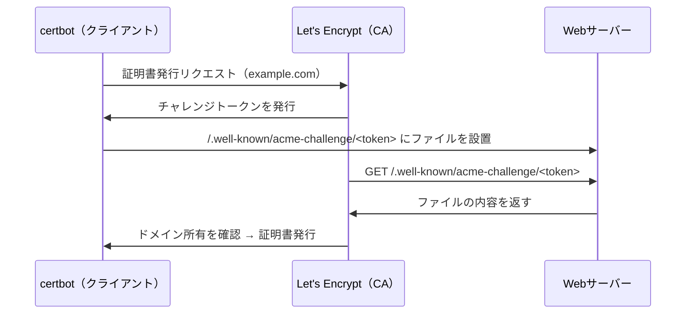

---
tags:
  - web
  - rfc
  - security
  - mcp
  - openid
created: 2026-09-05
---
## 概要

`.well-known` は、Webサーバーのルートに置く**特別な予約済みディレクトリ**。  
`https://example.com/.well-known/` 配下に、そのドメインに関するメタ情報・設定情報を置く場所として標準化されている。

- 定義: **RFC 5785**（2010年）、後に **RFC 8615**（2019年）で更新
- 管理: IANA が `.well-known` 配下のパス名（URI suffix）のレジストリを管理

---

## 命名の由来：なぜ "well-known" なのか

### 英語の意味
"well-known" = 「よく知られた・広く知られた」。  
転じて「事前に合意された・誰もが知っているべき場所」というニュアンス。

### RFC 5785 以前の問題

`.well-known` が生まれる前、各プロトコルは**それぞれ好き勝手な場所**にメタ情報を置いていた：

| 用途 | 当時のパス |
|------|-----------|
| robots.txt | `/robots.txt`（ルート直下） |
| favicon | `/favicon.ico`（ルート直下） |
| OpenID | `/openid-configuration`（場所はまちまち） |
| 証明書検証 | 実装依存 |

**問題点：**
- ルートに雑多なファイルが増える
- 他のアプリのルーティングと衝突する
- 「どこを見ればいいか」が標準化されていない

### RFC 5785 の解決策

> 「メタデータ系のパスは全部 `/.well-known/` 配下にまとめよう」

これで「`.well-known` を見れば何でもわかる」という**"well-known な場所"** が生まれた。  
ドットで始まる（`.well-known`）のは、Unix の慣習で「隠しディレクトリ・設定ファイル」を意味するため。

---

## 主要な用途一覧

### 1. TLS証明書の取得（ACME / Let's Encrypt）

```
GET https://example.com/.well-known/acme-challenge/<token>
```

**仕組み（HTTP-01 チャレンジ）：**



「このファイルを置けるなら、このドメインを管理しているはず」という証明。

---

### 2. OpenID Connect / OAuth 2.0

```
GET https://example.com/.well-known/openid-configuration
```

IdP（Identity Provider）の設定情報を JSON で返すエンドポイント。  
クライアントはここを見て「どのエンドポイントに認証リクエストを送ればいいか」を自動的に知る。

```json
{
  "issuer": "https://example.com",
  "authorization_endpoint": "https://example.com/oauth/authorize",
  "token_endpoint": "https://example.com/oauth/token",
  "jwks_uri": "https://example.com/.well-known/jwks.json"
}
```

**ポイント：** 設定をハードコードせず、自動検出（Auto-discovery）できる。

---

### 3. security.txt（RFC 9116）

```
GET https://example.com/.well-known/security.txt
```

セキュリティ研究者が脆弱性を発見したときの**連絡先**を示すファイル。

```
Contact: mailto:security@example.com
Expires: 2026-12-31T00:00:00Z
Encryption: https://example.com/pgp-key.txt
```

---

### 4. MCP（Model Context Protocol）

```
GET https://example.com/.well-known/mcp
```

Anthropic が策定した MCP（AIエージェントとツールをつなぐプロトコル）でも採用。  
MCPサーバーのエンドポイント情報をここに置くことで、クライアントが**自動検出**できる。

```json
{
  "mcp": {
    "endpoint": "https://example.com/mcp",
    "transport": "http"
  }
}
```

OIDC と同じ発想：「固定の場所を見れば接続先がわかる」。

---

### 5. その他の代表例

| パス | 用途 |
|------|------|
| `/.well-known/change-password` | パスワード変更ページへのリダイレクト（RFC） |
| `/.well-known/apple-app-site-association` | iOS Universal Links |
| `/.well-known/assetlinks.json` | Android App Links |
| `/.well-known/jwks.json` | JWT 署名検証用の公開鍵セット |
| `/.well-known/webfinger` | ActivityPub（Mastodon など）のユーザー情報検索 |

---

## 共通パターン：なぜ `.well-known` が選ばれるのか

各用途に共通する設計思想：

```
「固定の場所に置けば、事前の合意なしに自動発見できる」
```

1. **自動検出（Auto-discovery）** — 設定をハードコードしなくていい
2. **標準化** — どのドメインでも同じパスを見ればいい
3. **分離** — アプリのルーティングと干渉しない専用領域

---

## サーバー設定の注意点

### nginx

Let's Encrypt などでよく必要になる設定：

```nginx
# アプリの認証やリダイレクトを .well-known には適用しない
location /.well-known/ {
    allow all;
    # auth_basic をここでオフにする例
    auth_basic off;
}
```

### Caddy

Caddy は Let's Encrypt の ACME チャレンジを**自動処理**するため、通常は設定不要。

### SPA / リバースプロキシ構成での注意

フロントエンドが全パスを `/index.html` にフォールバックする構成だと、  
`.well-known` へのリクエストも HTML が返ってしまう → **明示的に除外**が必要。

---

## `.well-known` に入らなかったもの

RFC 8615 以前から存在し、**パスが仕様で固定されてしまった**ファイル群。  
歴史的経緯により `.well-known/` への移行ができず、ルート直下に残っている。

| ファイル | 固定パス | 標準化 | 理由 |
|---------|---------|--------|------|
| `robots.txt` | `/robots.txt` | RFC 9309（2022年） | 1994年から業界慣習として先に普及、Googlebot 等が決め打ちで取得 |
| `favicon.ico` | `/favicon.ico` | なし（慣習） | ブラウザが決め打ちでリクエスト |
| `sitemap.xml` | 慣習的に `/sitemap.xml` | なし（慣習） | `robots.txt` から参照する慣習として定着 |

### ポイント：なぜ移行できないのか

```
クライアント（ブラウザ・クローラー）が「このパスを見る」と実装済み
→ サーバー側だけ場所を変えても誰も見に来ない
→ 既存の実装を全部変えるコストが大きすぎる
```

これは `.well-known` が生まれた**動機そのもの**でもある。  
`robots.txt` や `favicon.ico` のようにルートが散らかることへの反省が RFC 5785 につながった。

### 2つの流派の整理

```
# 歴史的経緯でルート直下に固定（変えられない）
/robots.txt
/favicon.ico
/sitemap.xml

# RFC 8615 以降の新方式（.well-known 配下に統一）
/.well-known/acme-challenge/
/.well-known/security.txt
/.well-known/openid-configuration
/.well-known/mcp
```

> 新しく標準化されるプロトコルは原則 `.well-known/` に入る。  
> 今後 `robots.txt` 相当の新機能が作られるなら `.well-known/` に登録される。

---

## まとめ

| 項目 | 内容 |
|------|------|
| 定義 | Webサーバーのメタ情報を置く標準ディレクトリ |
| 規定 | RFC 8615（旧 RFC 5785） |
| 命名 | 「誰もが知っている＝事前合意された場所」から |
| 主な用途 | ACME（TLS）、OIDC、security.txt、MCP、App Links など |
| 共通思想 | 固定パスによる自動検出（Auto-discovery） |

`.well-known` は「このドメインについて何か知りたければここを見ろ」という**玄関口**。  
プロトコルが増えるたびに用途が広がり続けている。

---

## 参考リンク

- [RFC 8615 – Well-Known Uniform Resource Identifiers](https://www.rfc-editor.org/rfc/rfc8615)
- [IANA .well-known URI Registry](https://www.iana.org/assignments/well-known-uris/well-known-uris.xhtml)
- [Let's Encrypt – How It Works](https://letsencrypt.org/how-it-works/)
- [OpenID Connect Discovery](https://openid.net/specs/openid-connect-discovery-1_0.html)
- [RFC 9116 – security.txt](https://www.rfc-editor.org/rfc/rfc9116)
- [MCP Specification](https://modelcontextprotocol.io/)
- [RFC 9309 – Robots Exclusion Protocol](https://www.rfc-editor.org/rfc/rfc9309)

### 関連項目

- [[LLMエコシステムの4層構造]]
