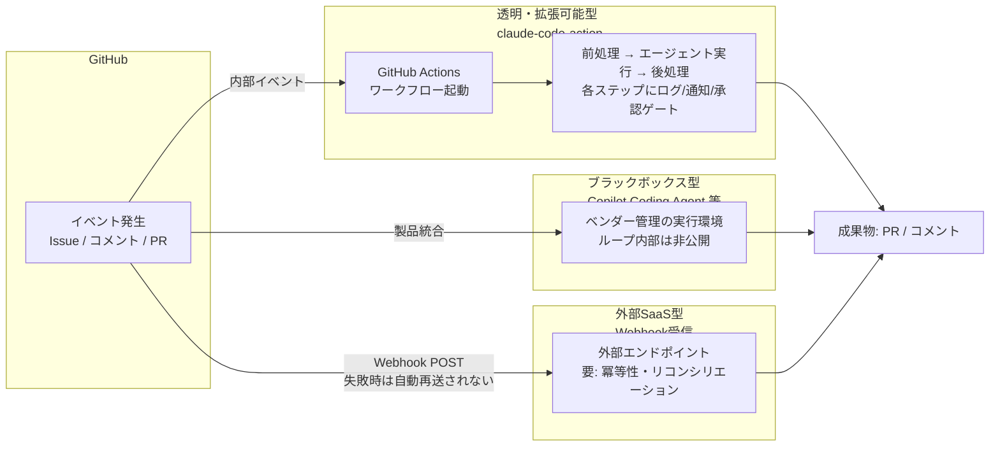

---
tags:
  - ai
  - agent
  - github-actions
  - orchestration
  - ci-cd
created: 2026-11-04
---

## 概要

クラウド上でイベントを契機に自律実行し、PR などの成果物を残して終了する AI エージェントについて、GitHub Copilot Coding Agent / claude-code-action / Cursor Automations を対比しながら「イベントがどう届くか」と「透明性」を整理する。

## クラウドエージェントとは

**クラウドエージェント**とは、開発者のローカル環境ではなく、クラウド上（CI/CD基盤やベンダーのホスト環境）で自律的にコード変更やタスクを実行するAIエージェントのこと。

- ローカル型（Claude Code, Cursor のエディタ内エージェント等）: 人間とターミナル／エディタで対話しながら動く
- クラウド型: イベントをきっかけに自動起動し、成果物（PR、コメントなど）を残して終了する、バッチ的な実行モデル

設計上の論点は大きく2つ。

1. **トリガー**: 何をきっかけにエージェントが起動するか
2. **オーケストレーション**: 起動後の実行ループを誰が管理し、どこまで中身が見えるか

## 詳細説明

### 3実装の比較

| 項目 | GitHub Copilot Coding Agent | claude-code-action (GitHub Actions) | Cursor Automations |
|---|---|---|---|
| 典型的なトリガー | Issueへのassign、PRコメントでの `@copilot` メンション | ワークフローの `on:` で自分で定義（`issue_comment`, `pull_request`, `workflow_dispatch` 等） | GitHubイベントやスケジュール（Cursor側の設定で定義） |
| 実行基盤 | GitHub管理のマネージド環境（詳細は非公開部分が多い） | GitHub Actionsランナー（GitHubホスト型 or セルフホスト型を選べる） | Cursor管理のクラウド環境 |
| ループの管理主体 | ベンダー（ブラックボックス） | ユーザー（YAMLでワークフローの前後処理を制御。エージェント内の各ツール実行は対象外） | ベンダー（UI設定ベース） |
| カスタマイズ性 | 低 | 高（前後処理、条件分岐、承認ゲート、通知を自由に追加） | 中 |

> 注意: Copilot Coding Agent と Cursor Automations の内部実装（実行基盤の詳細、イベント受信経路など）は公式に十分開示されていない部分があり、上表のうち「実行基盤」の記述は一般的な理解に基づく。正確な仕様は各公式ドキュメントで要確認。

**要点**: トリガーの概念（Issue / コメント / イベント）は3者でほぼ共通。違いが大きいのは **オーケストレーションの透明性**。

- ブラックボックス型（Copilot Coding Agent, Cursor Automations）: ユーザーが制御できるのは「起動条件」と「結果」だけ。途中経過はログとPR差分くらいしか手がかりがない
- 透明・拡張可能型（claude-code-action）: GitHub Actions自体がオーケストレーション層なので、エージェント呼び出しの前後のステップにログ、リトライ、承認ゲート、通知を挟める。エージェント内部の各ツール実行を Actions のステップにすることはできず、そこまで制御したい場合は Claude Code の hooks などを使う

### イベント配信の仕組み（push型）

GitHubはイベント発生時にWebhook（HTTP POST）で通知するpush型。ポーリングではない。ただし「誰がそれを受け取るか」で信頼性の設計が変わる。

| 観点 | GitHub Actions 内で完結する場合 | 外部SaaSにWebhookを飛ばす場合（GitHub App等） |
|---|---|---|
| 受信者 | GitHub自身のワークフロー起動基盤 | 外部サービスのエンドポイント |
| 障害時の責任範囲 | GitHub側（起動しない＝GitHub障害、キュー遅延、またはワークフローが無効／`on:` の条件やフィルターに一致しない） | 受信側の可用性にも依存する |
| 取りこぼしリスク | 低い（ただしキュー遅延、`schedule` トリガーの遅延・スキップは起こりうる） | 受信側ダウン中のイベントは取りこぼす可能性がある |
| 可視性 | Actionsの実行ログ・履歴で追える | GitHub側のWebhook Deliveries画面（アプリの管理者権限が必要）と受信側ログ |

**重要な訂正メモ**: GitHubのWebhookは、配信に失敗しても**自動再送されない**（再送は手動、またはAPIで失敗した配信を再配信する形）。「GitHubが自動リトライしてくれる」前提で受信側を設計してはいけない。

### SRE的な設計原則（外部エンドポイントでWebhookを受ける場合）

1. **冪等なイベント処理**: 同じイベントが重複配信されても二重実行しない。`X-GitHub-Delivery`（配信ID）で重複排除する
2. **リコンシリエーション**: Webhookを取りこぼす前提で、定期的にGitHub APIで状態を突き合わせ、差分を補完する
3. **配信状況の可視化**: Webhook Deliveriesの失敗履歴を監視し、失敗した配信は再配信する運用を用意する
4. **素早く2xxを返す**: 受信ハンドラは重い処理を非同期キューに逃がし、タイムアウトによる配信失敗を避ける

### 透明性が障害診断に与える影響

| 失敗モード | ブラックボックス型 | Actions型（claude-code-action） |
|---|---|---|
| そもそも起動しなかった | 原因の切り分けが難しい（イベント受信側が見えない） | ワークフロー実行履歴・`on:` 条件で切り分け可能 |
| 途中で失敗した | 実行中のセッションログ（ツール使用状況の確認が可能）と結果のPR、成功/失敗の表示が手がかり | 各ステップのログ、環境変数、出力を確認できる |
| 暴走・想定外の変更 | 事後のPR差分レビューで気づくしかない | 承認ゲートやパス制限を実行前後に挟める |
| 再現・再実行 | 同条件の再現が難しい | 同じワークフローの再実行が可能 |

LLMの出力は「サイレントな失敗」（例外もエラーログも出ない）を起こしうるため、エージェントの実行ログと差分を検査できる層を自分で持てることはSRE上の価値になる。

## 図解

## まとめ

- クラウドエージェントは「イベントで起動 → 成果物を残して終了」するバッチ型の実行モデル
- トリガーの概念は各実装でほぼ共通。差は**オーケストレーションの透明性**（誰がループを管理し、どこに介入ポイントを置けるか）
- GitHub Actions内で完結する構成は、イベント配信がGitHubの責任範囲に収まり、実行過程も見えるため、障害診断しやすい
- 外部SaaSにWebhookを飛ばす構成では、at-least-once前提の**冪等性**と、取りこぼし対策の**リコンシリエーション**が必須。GitHubはWebhookを自動再送しない点に注意
- 評価軸として「観測可能性」「介入ポイントの有無」を持つと、ベンダー型エージェントの比較がしやすい

## 次に深掘りできそうな点

- 権限スコープの設計（エージェントがGitHub / 外部APIに持つ権限の範囲と制御）
- 実行中の状態管理（途中失敗時のリトライ、冪等性、部分実行の扱い）
- 障害診断の具体シナリオ（PR生成失敗時の追跡手順など）

## 参考情報

### 参照元

| ソース | URL | 内容 |
|--------|-----|------|
| claude-code-action | https://github.com/anthropics/claude-code-action | GitHub Actions 上で動く Claude エージェント |
| GitHub Copilot coding agent | https://docs.github.com/en/copilot/concepts/coding-agent/about-coding-agent | マネージド型エージェントの仕様 |
| GitHub Webhooks: 失敗した配信の扱い | https://docs.github.com/en/webhooks/using-webhooks/handling-failed-webhook-deliveries | 自動再送されない前提の運用 |
| GitHub Webhooks: ベストプラクティス | https://docs.github.com/en/webhooks/using-webhooks/best-practices-for-using-webhooks | 冪等性・迅速な 2xx 応答など |
| Cursor ドキュメント | https://docs.cursor.com/ | Cursor Automations の設定 |

### 関連項目

- [[GitHub ModelsでIssueをPRに自動変換]] - GitHub イベント起点でエージェントを動かす具体例
- [[AIエージェントのコンテキスト管理]] - エージェントの実行ループと文脈管理の考え方
- [[AIツールチェーン管理]] - 複数のエージェント／CI ツールを併用する際の管理
