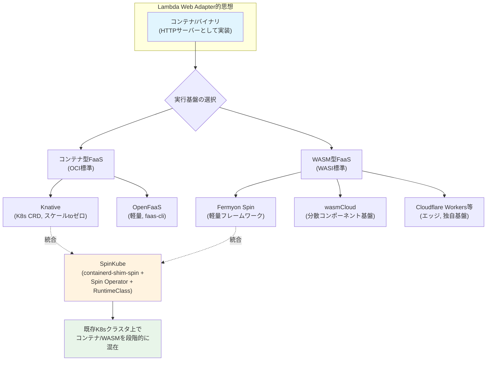

---
tags:
  - faas
  - serverless
  - wasm
  - knative
  - kubernetes
created: 2026-09-05
---
## 概要

AWS Lambda Web Adapterは「コンテナ/バイナリをHTTPサーバーとして書くだけで、Lambda固有のイベント形式に自動変換してくれる」仕組みであり、**Lambda特有のランタイム作法から解放される**のが本質。この「コンテナを渡せばFaaS化される」という互換思想を軸に、ベンダーロックなしで関数サービスを構築する方向性は大きく3系統に分かれる。

- **コンテナ型FaaS基盤**(Knative / OpenFaaS): K8s上でOCI標準コンテナをそのままFaaS化
- **WASM型FaaS**(Fermyon Spin / wasmCloud): WASI標準による、コンテナよりさらに強いポータビリティと高速起動
- **コンテナ×WASM統合**(SpinKube): 既存K8sクラスタにWASMワークロードを段階的に混在させる仕組み

## 詳細説明

### 1. コンテナ型FaaS基盤

| 選択肢 | 特徴 |
|---|---|
| **Knative** | K8sのCRDとしてFaaSを実現。コンテナイメージを渡すだけでスケールtoゼロ・オートスケール。GCP Cloud Runの実装基盤でもあり、YAMLの一部は共有できるが、移行時にはnamespaceの変更や未対応フィールドの削除が必要 |
| **OpenFaaS** | Knativeより軽量。K8s上では`faas-cli`でコンテナ化〜デプロイまで一貫。Docker Swarm向けの`faas-swarm`は非推奨・保守停止で、単一ノード向けの`faasd`はcontainerdを使いDockerとの同居も避ける必要がある。自宅ラボ規模ではKnativeより現実的な選択肢 |

Lambda Web Adapterとの共通点は「コンテナを渡せばFaaS化される」という互換思想。実行基盤をK8sという業界標準に寄せることでロックインを回避する。

### 2. WASM型FaaS

WASI(WebAssembly System Interface)という標準化されたシステムコールインターフェースにより、一度コンパイルしたWASMバイナリを別のランタイムへ移植できる。ただし実行先が必要なインターフェースとバージョンを提供する必要があり、例えば`wasi:http`をインポートするコンポーネントはホスト側の対応が必須である。

| 選択肢 | 特徴 |
|---|---|
| **Fermyon Spin** | WASM向け軽量FaaSフレームワーク。ローカル〜Fermyon Cloud〜自前K8s(SpinKube)まで同じ成果物で展開可能 |
| **wasmCloud** | アクター/コンポーネントモデルベースの分散WASMランタイム。単なる関数実行を超え「疎結合コンポーネントの実行基盤」を志向 |
| **Cloudflare Workers / Fastly Compute@Edge** | 商用エッジ実行環境。起動速度はミリ秒未満級だが、基盤自体は各社独自でロックインの余地あり |

**コンテナ型 vs WASM型の比較**

| 観点 | コンテナ型 | WASM型 |
|---|---|---|
| 起動速度 | 数百ms〜秒 | 数ms〜数十ms |
| ポータビリティ | OCI標準で高い | WASI標準でさらに高い(OS依存を排除) |
| エコシステム成熟度 | 高い(K8s資産をフル活用) | 発展途上、対応言語・ライブラリに制約あり |
| ネットワーク/ファイルI/O | ほぼ制約なし | WASIの実装状況に依存、まだ発展中 |

現状は「本番の主力基盤としてはコンテナ型、エッジやレイテンシ最優先の局所ユースケースにWASM型を組み合わせる」のが現実的な立ち位置。

### 3. SpinKube: コンテナ×WASMの統合

WASMワークロードをK8sネイティブなリソースとして扱うための一連のコンポーネント群。

- **containerd-shim-spin**: containerdのシムとして動作し、WASMバイナリを通常のPodと同じライフサイクルで実行可能にする。K8sから見ると「特殊なコンテナランタイム」程度の扱い
- **Spin Operator**: `SpinApp`というCRDを提供し、`kubectl apply`でWASMアプリをデプロイ可能。Deployment/Serviceの概念をWASM向けに抽象化
- **RuntimeClass**: K8s標準機能。Pod単位で「WASMランタイムで実行する」と指定でき、通常のDockerコンテナPodと共存可能

**実務上の意味**: 既存K8sクラスタ(監視・ネットワークポリシー・RBACなどそのまま)の上に、WASMワークロードを追加のPodタイプとして混在させられる。Knative/OpenFaaSで運用しているクラスタに対し、レイテンシシビアな一部の関数だけをSpinKube経由のWASMに置き換える、といった段階的移行がしやすい設計。

**制約**
- 対応言語はWASM/WASIコンパイル可能なもの(Rust, Go(TinyGo), JS/TSなど)に限定
- ネットワークI/O・ファイルシステムアクセスはWASIのcapability経由で明示的に許可する必要があり、既存アプリの単純移植は難しいケースが多い

## 図解

## まとめ

- Lambda Web Adapterの「既存資産(HTTPサーバー)を活かしつつポータビリティを確保する」という思想は、Knative/OpenFaaSなどのコンテナ型FaaS基盤に最も素直に継承されている
- WASM型FaaSはさらに強いポータビリティと高速起動を提供するが、エコシステムはまだ発展途上で、対応言語やI/Oまわりに制約がある
- SpinKubeはコンテナ型とWASM型の橋渡し役として、既存K8sクラスタを維持したまま段階的にWASMの恩恵を取り込める点で実務的に有力
- 現実的な落とし所は「主力はコンテナ型FaaS、レイテンシシビアな部分にWASM型を局所適用」という併用戦略

## 参考リンク

- Knative: https://knative.dev/
- OpenFaaS: https://www.openfaas.com/
- Fermyon Spin: https://www.fermyon.com/spin
- wasmCloud: https://wasmcloud.com/
- SpinKube: https://www.spinkube.dev/

### 関連項目

- [[Cloudflare OS]]
- [[Linuxコンテナのnamespaceとcgroups]]
